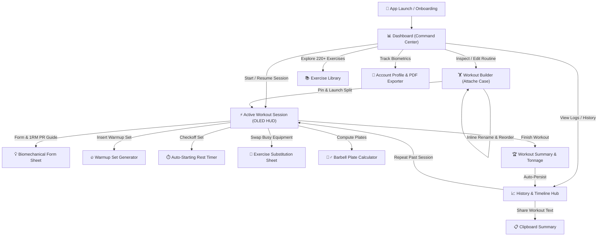

<div align="center">

```text
██╗     ███████╗ ██████╗ ███╗   ██╗
██║     ██╔════╝██╔═══██╗████╗  ██║
██║     █████╗  ██║   ██║██╔██╗ ██║
██║     ██╔══╝  ██║   ██║██║╚██╗██║
███████╗███████╗╚██████╔╝██║ ╚████║
╚══════╝╚══════╝ ╚═════╝ ╚═╝  ╚═══╝
```

### Premium Minimalist Fitness OS

*Fast. Data-Dense. Distraction-Free.*

[](https://flutter.dev)
[](https://dart.dev)
[](https://riverpod.dev)
[-F8981D?style=flat-square)](https://pub.dev/packages/hive_ce)
[](#5-exercise-library--custom-movements-libfeaturesexercise_library)
[](https://dart.dev/tools/analysis)
[](#-tech-stack--architecture)
[](./lib/core/theme)

</div>

---

## 📖 Executive Summary

**LEON** is a high-performance fitness operating system engineered for lifters who prioritize precision, execution speed, and transparent data over decorative gimmicks. Built in Flutter and Dart, LEON marries **Noguchi-inspired Japanese/Swiss monochrome luxury** with strict **Apple Human Interface Guidelines (HIG)** discipline.

Operating under a **local-first** architecture, every session, set, rep, and custom routine is stored directly on-device using Hive CE — delivering instant 120Hz responsiveness, zero network lag, and crash-resilient offline autonomy in any gym environment.

---

## 🧭 Complete Application Navigation & User Workflows



---

## 🌟 Core Modules & Feature Breakdown

### 1. Dynamic Onboarding & Goal Engine (`lib/features/onboarding`)
* **7-Screen Interactive Survey:** Guides new lifters through primary goal selection, biometrics (Weight, Height, Age), target body weight, weekly training frequency, and muscle focus areas.
* **Dynamic Goal Adaptation:**
  * **Bulking:** Targets 8–12 hypertrophy reps, 90–120s rest periods, and high weekly set volume.
  * **Cutting:** Prioritizes training density, 60–90s rest, and daily calorie/step pacing.
  * **Strength:** Auto-configures 3–6 heavy reps, 180s rest intervals, and estimated 1RM PR targets.
  * **Maintenance & Recomposition:** Focuses on balanced work capacity and lean tissue preservation.
* **Guest Mode Bypass:** Lifters can skip the survey instantly with 1 tap and start training with sensible defaults.

### 2. Dashboard — The Command Center (`lib/features/dashboard`)
* **Retractable Calendar Header:** Pinned weekly strip with a tactile grab handle that expands into a full monthly overview with color-coded workout indicators.
* **Recovery Readiness ECG Widget:** Calculates physiological readiness score based on weekly volume load, workout frequency, and self-reported sleep/hydration. Includes a science explanation modal on info tap.
* **Restored 2×2 Bento Grid:** High-contrast square cards tracking daily habits:
  * 👟 **Daily Steps:** Real-time step counter with target progress bar, horizontal history, and 3-metric summary (Goal, Step count, Distance).
  * 🔥 **Active Calories:** Energy expenditure counter.
  * 💧 **Hydration / Water:** Water intake tracker with 1-tap quick log modal.
  * 🌙 **Sleep Duration:** Sleep logging with restorative recovery rating.
* **Daily Workout Spotlight:** Displays today's scheduled workout from your active split. If an active session is in progress, it automatically updates to a glowing **`▶ RESUME WORKOUT`** button.
* **Instant Routine Editor Bypass (`EDIT ROUTINE`):** 1-tap button on the workout detail sheet directly opens that specific split inside the Routine Editor, eliminating multi-step navigation friction.
* **Completed Session Deep Link (`VIEW LOGS`):** When today's workout has already been logged, tapping the card surfaces a direct **`VIEW LOGS`** button that jumps straight to that completed session in History.

### 3. Workout Builder — The Attache Case (`lib/features/workout_builder`)
* **Pre-Loaded Scientific Training Splits:**
  * **Push Pull Legs (PPL):** 6-Day Hypertrophy focus (114 weekly sets)
  * **Upper / Lower (U/L):** 4-Day Strength & Mass focus (81 weekly sets)
  * **Arnold Split:** 6-Day Antagonist volume focus (118 weekly sets)
  * **5-Day Bro Split:** 5-Day Bodypart specialization (95 weekly sets)
* **Pinned Active Split Card & Expanded Detail Sheet:** The active routine is permanently pinned at the top with a dedicated **`ACTIVE`** status badge. Tapping opens an in-depth modal displaying weekly volume distribution, muscle radar balance, scheduled days, and direct edit actions without endless scrolling.
* **Inline Day Renaming & Quick Presets:** Tap any workout day in the Routine Editor to rename it instantly with intelligent quick chips (*Push Day*, *Pull Day*, *Leg Day*, *Upper Body*, *Lower Body*, *Arms & Shoulders*, *Full Body*, *Core & Cardio*) or toggle it as a Rest Day.
* **"Set as Active Routine" Switch:** Integrated toggle switch positioned directly above **`SAVE ROUTINE`** that automatically activates the routine upon saving.
* **Interactive 6-Axis Muscle Radar Canvas:** Custom-painted polygon canvas comparing planned routine volume vs actual 14-day logged volume across Chest, Back, Shoulders, Quads, Hamstrings, and Arms.
* **Routine Library Screen:** Build, clone, edit, and organize custom multi-week routines with drag-and-drop exercise reordering.
* **Freestyle Workout Launcher:** 1-tap direct launch for unstructured or impromptu gym sessions.

### 4. Active Workout Session — OLED Distraction-Free HUD (`lib/features/workout_session`)
* **Biomechanical Form & PR Guide (`(i)`):** Instant 1-tap coaching sheet on every exercise card detailing step-by-step setup, execution cues, target primary/secondary muscle tags, and all-time Estimated 1RM personal records.
* **Warmup Set Generator (`+ WARMUP`):** 1-tap warmup set insertion calculating 50% working weight (or progressive multi-tier ramp) with distinct set badges:
  * **`W`** — Warmup Set (volume excluded from working load totals)
  * **`D`** — Drop Set
  * **`F`** — Set to Absolute Failure
  * **`1..N`** — Regular Working Sets
* **Auto-Starting Rest Timer with Interactive Duration Pill:** Rest timer triggers automatically as soon as a set is completed. Features a tactile `AUTO / MANUAL` toggle chip, real-time countdown, $\pm10\text{s}$ adjustment chips, and an interactive duration picker pill (30s, 60s, 90s, 120s, 180s, 240s).
* **Crash Protection & Auto-Resume:** Every set, weight modification, and rep completion is instantly serialized to Hive DB. If your phone battery dies or the app closes, your session is restored seamlessly on relaunch.
* **1-Tap Previous Workout Ghost Data:** Automatically renders previous session performance (e.g. `80 kg × 8`) in ghost text. Tapping the ghost text instantly populates current inputs.
* **In-Workout Exercise Substitution Sheet:** When gym machines or benches are occupied, tap the 3-dot menu to swap the exercise. LEON automatically filters the catalog for matching agonist muscle groups (e.g., swapping *Barbell Bench Press* for *Dumbbell Bench Press* or *Machine Chest Press*) while preserving already completed sets.
* **Visual Barbell Plate Calculator:** Barbell diagram computing exact Olympic plate breakdowns (25kg, 20kg, 15kg, 10kg, 5kg, 2.5kg, 1.25kg) per sleeve for any target load.
* **Real-Time Sine-Wave Tempo Pacer:** Visual animated sine-wave guide with haptic ticks for controlled muscle cadence (e.g., `3-0-1-0` tempo: 3s eccentric, 0s pause, 1s concentric, 0s top hold).
* **Dual Effort Picker (RIR & RPE):** Choose between Reps In Reserve (0 to 4+) or Rate of Perceived Exertion (6.0 to 10.0) with color-coded exertion feedback.
* **Workout Summary Dialog:** Post-session recap displaying total duration, total tonnage lifted, set counts, PR badges, and goal-adapted encouragement.

### 5. Exercise Library & Custom Movements (`lib/features/exercise_library`)
* **220+ Curated Gym Exercises:** Comprehensive catalog spanning barbells, dumbbells, cables, machines, and bodyweight movements (including Safety Squat Bar Squats, Bulgarian Split Squats, Deficit Deadlifts, Face Pulls, and Incline Dumbbell Curls).
* **Instant Filtering & Debounced Search:** Filter instantly by muscle group (Chest, Back, Shoulders, Legs, Arms, Core), equipment type, and compound/isolation pattern.
* **High-Visibility "Custom" Filter Chip:** Dedicated filter chip in the horizontal filter bar and master filter sheet that instantly isolates user-created custom movements.
* **Seamless Custom Movement Creation:** Add and save custom exercises with muscle and equipment assignments; automatically focuses the Custom filter with confirmation snackbars upon saving.
* **Full Exercise Detail Screen:** Complete guide featuring anatomical primary/secondary muscle highlights, step-by-step setup and execution bullet points, common safety pitfalls, and an interactive 1RM calculator.

### 6. History & Performance Hub — The Timeline Hub (`lib/features/history`)
* **"Repeat Workout" 1-Tap Launcher:** Instantly restart any past workout session with previous exercises, set counts, and working weights preloaded into the active session with smart conflict handling.
* **Workout Summary Sharing (`SHARE`):** 1-tap generator that creates a clean, formatted plain-text workout summary (exercises, sets, reps, loads, PR highlights, and total tonnage) directly to the system clipboard with tactile feedback.
* **Collapsible Notched Calendar:** Pinned header with an ergonomic grab handle. Collapses to a 1-week strip or expands to a 6-row monthly calendar.
* **Strict 1-Workout-Per-Day Rule:** Enforces accurate calendar alignment with color-coded status:
  * 🟢 **Solid Emerald Green (`#00E676`):** Completed workout days.
  * ⚪ **Solid Pure White (`#FFFFFF`):** Today.
  * 🔴 **Soft Red (`#FF5252`):** Missed scheduled workouts.
  * ⚫ **Slate Onyx (`#262D3D`):** Planned rest days.
  * 🔵 **Electric Cyan Ring:** Active date filter.
* **Retroactive Workout Log Editor:** Tap any historical workout to edit logged weights, reps, or notes to fix gym-floor typos.
* **Progressive Overload Analytics:** Scientific estimated 1RM progression curves plotted via `fl_chart` using the Epley formula:
  $$\text{1RM} = \text{weight} \times \left(1 + \frac{\text{reps}}{30}\right)$$
  Filters across 1 Month, 3 Months, 6 Months, 1 Year, or All Time.
* **Lifetime Tonnage Progress Bar:** Tracks cumulative kilograms lifted against milestone targets.

### 7. Health Tracking & Body Recomposition (`lib/features/health_tracking`)
* **Daily Health Metrics:** Direct logging for daily step counts, active calories, water intake, and sleep duration.
* **Body Recomposition Logger:** Dedicated tracker for physical body measurements (Waist, Chest, Arms, Thighs) and Body Fat Percentage.
* **30-Day Delta Calculations:** Highlights true body composition trends over time (e.g., `-2.0 cm waist`, `+1.0 cm arm`).

### 8. Account Profile & Athletic PDF Exporter (`lib/features/profile`)
* **Biometrics Engine:** Live computation of BMI, Basal Metabolic Rate (BMR), Total Daily Energy Expenditure (TDEE), and daily protein targets.
* **Goal Switcher Modal:** Change primary training goals anytime without resetting historical workout logs.
* **1-Page Athletic PDF Report Exporter:** Generates a vector PDF summary detailing total tonnage, PR highlights, routine distribution, and biometric progress for personal archiving or sharing with a coach.

---

## 🎨 Design System & Principles

LEON enforces a strict, minimalist design system governed by four mandatory rules:

```text
┌────────────────────────────────────────────────────────────────────────┐
│  LEON Noguchi Minimalist Palette                                       │
│  ├─ Canvas Onyx Background  │ #0F131B (Deep distraction-free base)     │
│  ├─ Card Surface Charcoal   │ #27262A (Frosted matte bento surfaces)   │
│  ├─ Border Steel            │ #383B42 (Subtle architectural framing)   │
│  ├─ Primary Accent Cyan     │ #00E5FF (Interactive CTAs & highlights)  │
│  ├─ Status Accent Amber     │ #FFB300 (Active selection & warnings)    │
│  ├─ Luminous Pure White     │ #FFFFFF (Primary headings & numbers)     │
│  └─ Secondary Slate-400     │ #94A3B8 (High-contrast labels >= 4.5:1)  │
└────────────────────────────────────────────────────────────────────────┘
```

1. **Apple HIG Typography Floor (Min 11.0 pt):** Every piece of text, tag, badge, timestamp, metric caption, and button label strictly observes an 11.0 pt floor. Never drops below 11 pt anywhere in the application.
2. **WCAG Contrast Threshold (Min 4.5:1 AA / AAA):** Secondary text uses light slate (`#94A3B8` / `#B8BCC3`), delivering high contrast against dark backgrounds. No faint 35–45% opacity washes.
3. **Disciplined 2-Accent Hierarchy:** Electric Cyan (`#00E5FF`) for primary calls to action ("Start Workout", active workout indicators) and Amber (`#FFB300`) for active calendar day selection and recovery status.
4. **Standard Gym Terminology:** Strictly zero pseudo-military or sci-fi roleplay keywords (`protocol`, `cadence`, `telemetry`, `operative`, `commence`). Only clean, professional, normal gym and fitness terminology.

---

## 🛠️ Tech Stack & Architecture

| Layer | Technology | Details |
| :--- | :--- | :--- |
| **Framework** | **Flutter 3.x / Dart 3.x** | Multi-platform 120Hz declarative UI engine |
| **State Management** | **Riverpod 3** | Pure immutable state using `Notifier` / `AsyncNotifier` |
| **Local Storage** | **`hive_ce`** | High-performance local-first storage; models serialized as JSON |
| **Navigation** | **`go_router`** | Declarative routing with persistent `ShellRoute` navigation pill |
| **Data Models** | **Freezed & JSON Serializable** | Immutable models with type-safe copy, equality, and JSON codecs |
| **Custom Graphics** | **Flutter `CustomPainter`** | Hand-crafted 6-axis Radar Balance Canvas & Barbell Plate Diagram |
| **PDF Generation** | **`pdf` & `printing`** | Vector-rendered 1-page athletic performance reports |
| **Code Quality** | **Flutter Analyze & Test** | **0 static analysis issues**; **135+ automated unit & widget tests** |

---

## 📁 Codebase Directory Structure

```text
lib/
├── core/
│   ├── constants/          # Route constants, timing constants, storage keys
│   ├── router/             # GoRouter configuration & AppRouter build
│   ├── theme/              # AppColors, AppTheme, AppTypography (HIG compliant)
│   └── utils/              # StrengthMath (Epley 1RM formula, volume calculators)
├── features/
│   ├── authentication/     # Login, signup, and guest bypass
│   ├── dashboard/          # Retractable calendar, 2x2 bento grid, recovery ECG, workout detail sheet
│   ├── exercise_library/   # 220+ exercise catalog, search, filter chips, custom exercise creator
│   ├── health_tracking/    # Daily metrics, body recomposition logger, 30-day deltas
│   ├── history/            # Notched calendar, 1RM curves, workout session logs, repeat & share
│   ├── onboarding/         # 7-screen survey, dynamic training goal engine, radar widget
│   ├── profile/            # Biometrics, goal selector, preferences, PDF athletic report
│   ├── recovery/           # Physiological readiness scoring and muscle recovery
│   ├── workout_builder/    # Split presets, active split detail, routine editor, inline renamer
│   └── workout_session/    # OLED HUD, rest timer, plate calc, ghost autofill, form guide, warmup generator
├── models/                 # Freezed models (Exercise, Workout, Split, SessionLog, HealthLog)
├── services/               # HiveService, storage boxes, sync status
└── shared/
    └── widgets/            # Liquid glass nav pill, LeonButton, GlassCard, SyncStatusIndicator
```

---

## 🚀 Getting Started

### Prerequisites
* **Flutter SDK:** `>=3.38.0`
* **Dart SDK:** `^3.8.0`
* **Platform:** Android (API 34+) / iOS (iOS 16+) / Desktop

### Quickstart Installation

1. **Clone the repository:**
   ```bash
   git clone https://github.com/LuvyaNishad/GYM_APP.git
   cd leon
   ```

2. **Install project dependencies:**
   ```bash
   flutter pub get
   ```

3. **Verify static analysis (0 warnings):**
   ```bash
   flutter analyze lib test
   ```

4. **Run the automated test suite:**
   ```bash
   flutter test -j 1
   ```

5. **Launch the application on emulator or connected device:**
   ```bash
   flutter run
   ```

---

## 🗺️ Product Roadmap & Upcoming Milestones

Refer to [TODO.md](./TODO.md) for the active production backlog:
- [ ] **Cloud Sync & Multi-Device Backup:** Supabase / Firebase authentication & cloud synchronization
- [ ] **Lock Screen Live Activity:** Android Foreground Service notification & iOS Dynamic Island widget
- [ ] **Rest Timer Audio Sound Pack:** Audio assets with headphone ducking
- [ ] **Nutrition & Macro Tracking:** Barcode food scanner (OpenFoodFacts) & macro targets
- [ ] **Smartwatch Companion App:** Wear OS & Apple Watch wrist set logging
- [ ] **Social Workout Brag Cards:** 9:16 high-contrast Instagram Story recap generator.

---

<div align="center">

**LEON** — Built with precision. Trained with intent.

</div>